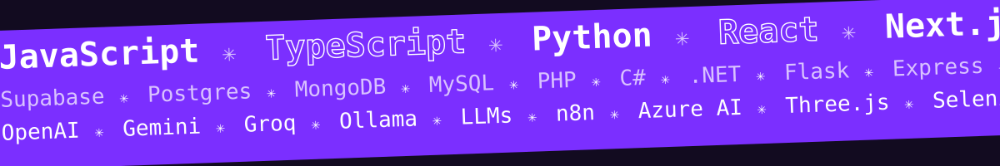

  

Oi! Eu sou a Thalita, mas pode me chamar de **TT**.

Sou desenvolvedora fullstack e faço sites, APIs e ferramentas com IA. Gosto mesmo é quando a coisa sai do editor e resolve o problema de alguém de verdade.

### Como eu vim parar aqui

Aos 7 anos pedi um computador de presente, daqueles de monitor enorme, e passava horas jogando e fuçando em tudo. Foi no Tumblr que vi HTML pela primeira vez, e aos 16 já estudava HTML e CSS por conta própria. A curiosidade virou profissão.

Hoje eu trabalho do front ao banco, com um pé bem firme em IA: chatbot, automação, modelo rodando local. Meu jeito é prototipar rápido, colocar na mão de alguém e ir ajustando com o que essa pessoa me conta.

> Problema sempre vai ter. O segredo é curtir o caminho de resolver.

### No que eu tô mexendo agora

- um app de finanças pra casal, pra dividir conta e planejar junto sem briga
- estudando engenharia de IA, que é onde eu quero ir cada vez mais fundo
- o meu [portfólio](https://telessthalita.com.br), que tem uma assistente chamada Friday. Passa lá e dá um oi pra ela

  

### Algumas coisas que eu fiz

| Projeto | O que é |
|---|---|
| [**Meu portfólio**](https://telessthalita.com.br) | Roxo, cheio de animação e com a Friday respondendo sobre mim com IA |
| [**Kleiton Moreira**](https://kleitonmoreira.com.br) | Site de um personal trainer, com painel pra ele mesmo editar o conteúdo |
| [**Brisa da Barra**](https://tabacariabrisadabarra.com.br) | Catálogo de uma tabacaria com carrinho e pedido fechado no WhatsApp |
| [**MoodTunes**](https://moodtuness.lovable.app) | Você conta como tá se sentindo e ele monta a playlist no seu Spotify |
| [**AI Corporate Assistant**](https://github.com/telessthalita/ai-corporate-assistant) | Classifica chamados internos com IA rodando local, sem mandar dado pra fora |
| [**CaseGenAI**](https://github.com/telessthalita/casegenai) | Pega as métricas de uma startup e devolve um case que dá vontade de ler |

  <picture>
    <source media="(prefers-color-scheme: dark)" srcset="https://raw.githubusercontent.com/telessthalita/telessthalita/output/cobrinha-dark.svg">
    
  </picture>

### Bora conversar?

Se você tem uma ideia pra tirar do papel, ou só quer trocar uma ideia sobre IA, me chama:

  
  
  

<b>English version</b>

 

Hi! I'm Thalita, but you can call me **TT**.

I'm a fullstack developer who builds websites, APIs and AI tools. My favorite part is when the thing leaves the editor and actually solves someone's problem.

At 7 I asked for a computer as a present, one of those with a huge monitor, and spent hours playing and poking at everything. Tumblr is where I first saw HTML, and by 16 I was teaching myself HTML and CSS. Curiosity became a career.

These days I work from front end to database, with one foot firmly in AI: chatbots, automation, models running locally. I like to prototype fast, put it in someone's hands and keep adjusting with what they tell me.

> There will always be problems. The secret is enjoying the road to solving them.

Right now I'm building a money app for couples and studying AI engineering. Come say hi to Friday, my assistant, on [my portfolio](https://telessthalita.com.br).

